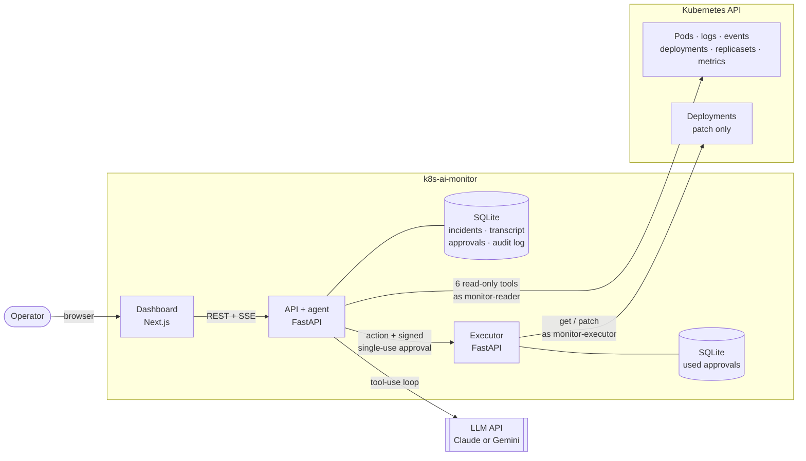
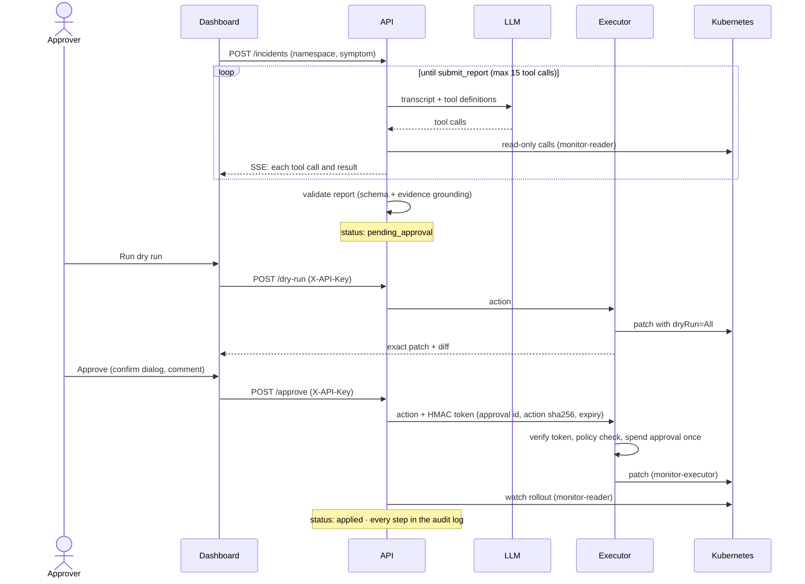

# Kubernetes AI Monitor

An AI SRE agent that investigates Kubernetes incidents with **read-only** tools, writes a
root-cause report with evidence, and proposes a fix that is applied **only after a human
approves it**. A separate executor applies the change under its own tightly scoped identity.
The model can be Claude or Gemini.

```
incident → agent investigates (read-only) → root-cause report + proposed fix
         → server-side dry run → human approves in the dashboard → executor applies → audited
```

On the bundled chaos benchmark, the agent finds the root cause of **6/6** reproducible failures
and makes the right remediation decision in **6/6**, including the two where the right answer
is "no automated fix". Investigations take 4–10 s ([results](#benchmark)).

---

## Contents

- [Architecture](#architecture)
- [Security model](#security-model)
- [Quickstart (kind, about 5 minutes)](#quickstart-kind-about-5-minutes)
- [Sample report](#sample-report)
- [Benchmark](#benchmark)
- [Development](#development)
- [Known limitations](#known-limitations)

## Architecture



| Component | Code | Identity |
|---|---|---|
| **Agent loop**: manual tool-use loop with caps, timeouts, token budget, report validation | [`backend/app/agent`](backend/app/agent) | (calls the LLM) |
| **Read-only tools**: `list_pods`, `describe_pod`, `get_pod_logs`, `get_events`, `get_rollout_status`, `get_metrics` | [`backend/app/agent/tools`](backend/app/agent/tools) | `monitor-reader` |
| **LLM providers**: Claude (default) or Gemini behind one interface | [`backend/app/agent/providers`](backend/app/agent/providers) | |
| **API**: incidents, live trace (SSE), approvals, audit, health | [`backend/app/api`](backend/app/api) | `monitor-reader` |
| **Executor**: a separate service that applies approved actions only | [`backend/app/executor`](backend/app/executor) | `monitor-executor` |
| **Dashboard**: live timeline, report, dry-run diff, approve/reject | [`frontend`](frontend) | none |
| **Chaos benchmark**: 6 reproducible failures with ground truth | [`chaos`](chaos) | admin (harness only) |

The approval flow, end to end:



## Security model

The model reads untrusted text: pod logs, event messages, and annotations written by the very
workloads that are failing. Any of it could contain a prompt injection. So the design assumes
the model can be manipulated, and makes sure that being manipulated can't directly change
anything.

**1. The agent can only read, and that's enforced in three layers.**
- **RBAC:** the `monitor-reader` ServiceAccount has a namespaced Role with `get/list/watch` on
  pods, `pods/log`, events, deployments, replicasets, and pod metrics only. No secrets, no
  configmaps, no exec, nothing cluster-wide ([`10-reader-rbac.yaml`](deploy/k8s/10-reader-rbac.yaml)).
- **In code:** the API clients are wrapped in a proxy that refuses any method that isn't
  `read_*`/`list_*`/`get_*` ([`core/k8s.py`](backend/app/core/k8s.py)), and a test parses the
  tool source to check it never references a mutating call.
- **Data minimization:** `describe_pod` shows env var *names* and their sources, never values.
  Tool output is size-capped.

**2. Writes need a different identity, in a different process.** The executor runs as
`monitor-executor`: `get`/`patch` on deployments and `get` on replicasets, only in allowlisted
namespaces. No create, no delete, no list, no secrets, no core resources at all
([`20-executor-rbac.yaml`](deploy/k8s/20-executor-rbac.yaml)). Its Kubernetes access is further
limited in code to exactly three methods. The API pod never holds write credentials, and the
executor never holds the LLM key.

**3. Only four actions, strictly validated.** `patch_resources`, `rollout_restart`,
`rollout_undo`, and `scale`, each checked against a strict schema: no unknown fields, Kubernetes
quantities under configured maximums, replica bounds, requests ≤ limits, and the namespace must
be on the allowlist. For `rollout_undo` the executor confirms by direct read that the target
ReplicaSet belongs to this deployment and is an earlier revision.

**4. A human approves the exact change.** The agent's report goes to `pending_approval`. An
approver (API key → name) must run a **server-side dry run** to see the precise patch, then
approve it in a confirm dialog. Approval issues an HMAC token bound to the approval ID, the
**sha256 of the exact action**, and a 5-minute expiry. The executor checks all three and records
the approval in **its own** database, so a token can be used only once even if replayed.
Rejected incidents can never be applied.

**5. Everything is audited.** Every state change goes through a compare-and-swap state machine
and writes an audit row (who, what, when, before/after) in the same transaction. SQLite triggers
reject `UPDATE`/`DELETE` on the audit table.

**6. Defense in depth around it:**
- The model's report must cite tools it actually called, and its fix must target the
  namespace that was investigated.
- Containers run non-root with read-only filesystems and all capabilities dropped.
- A NetworkPolicy lets only the API reach the executor.
- Images are digest-pinned, Trivy-scanned (fails on fixable HIGH/CRITICAL), and the repo is
  scanned for secrets.

Each guarantee above has a test: RBAC manifests (static checks, plus live `can-i` and
SelfSubjectAccessReview checks on kind), no execution without approval, rejected actions can't
run, approvals can't be reused, non-allowlisted namespaces and invalid parameters are refused,
tokens can't be tampered with or used after expiry, and the audit table rejects edits.

## Quickstart (kind, about 5 minutes)

**Prerequisites:** Docker, [kind](https://kind.sigs.k8s.io/), kubectl, and an LLM API key: a
Gemini key ([Google AI Studio](https://aistudio.google.com/apikey); the free tier works) or a
Claude key. On Windows, run the `.sh` scripts from Git Bash. Plan on about 5 minutes once the
images are built; the very first `--build` adds a few minutes for dependency installs.

```bash
# 1. Cluster: kind + namespaces + both ServiceAccounts' RBAC + metrics-server
deploy/scripts/setup-kind.sh

# 2. A workload that gets OOMKilled (32Mi limit, ~40MB working set)
kubectl apply -f deploy/demo/checkout-oom.yaml

# 3. Configuration
cp .env.example .env
#   LLM_PROVIDER=gemini and GEMINI_API_KEY=...   (or ANTHROPIC_API_KEY=... for Claude)
#   APPROVAL_SIGNING_KEY and EXECUTOR_API_KEY:   python -c "import secrets; print(secrets.token_urlsafe(48))"
#   APPROVER_API_KEYS=alice:<a long random key>  (enter this key in the dashboard)

# 4. Run: API + executor + dashboard, using per-identity kubeconfigs on kind's network
deploy/scripts/compose-kubeconfigs.sh
docker compose up --build
```

Open **http://localhost:3000** and click **New investigation** (namespace `demo`, target
`checkout`, symptom "pods keep restarting"). Watch the agent's tool calls arrive live, read the
report, click **Set approver key**, **Run dry run**, and **Approve**. The pod comes back healthy
(`kubectl -n demo logs deploy/checkout` → `catalog loaded ... serving`). The full trail is on the
**Audit log** page. API docs: http://localhost:8000/docs.

This exact flow was verified on kind with `gemini-3.5-flash-lite`: the investigation took about
11 s, the dry run showed `memory: 32Mi → 128Mi`, the fix was approved, and the pod went
`1/1 Running`.

**No API key?** [`backend/scripts/demo_server.py`](backend/scripts/demo_server.py) runs the
whole stack (real tools, cluster, SSE, and executor) with a clearly labeled scripted stand-in
for the model.

## Sample report

A real report from the quickstart above (`gemini-3.5-flash-lite`, 5 tool calls, about 11 s).
Full JSON: [`docs/sample-report.json`](docs/sample-report.json).

> **Summary:** The checkout pods are repeatedly restarting with OOMKilled status because a
> recent deployment configuration set the container memory limit to 32Mi, while the
> application's startup script attempts to allocate ~38.1 MB of memory.
>
> **Root cause** (confidence: **high**): The checkout deployment container has a memory limit
> of 32Mi, but its startup command allocates 40,000,000 bytes (~38.1 MB) into memory, exceeding
> the limit and causing container termination with OOMKilled (exit code 137).
>
> **Evidence:**
> - `list_pods`: `"status_reason":"OOMKilled"` shows the pod is failing due to OOMKilled.
> - `describe_pod`: `"reason":"OOMKilled","exit_code":137 … "limits":{"memory":"32Mi"} …
>   head -c 40000000 /dev/zero` shows a 32Mi limit while startup allocates 40,000,000 bytes.
>
> **Proposed fix:** `patch_resources` on `demo/checkout`, `{container: app, memory_limit: 128Mi}`.
> Risk: low.
>
> **Alternative hypotheses:** "Rollout undo to the previous revision (checkout-c87575bc5)…"

That last line is a real weakness, left in on purpose: the deployment had just been recreated,
and the model picked up **stale events** from an earlier deployment in the same namespace. It
correctly listed this as an alternative, not as the fix (see
[limitations](#known-limitations)).

## Benchmark

Six reproducible failures, each deployed into a fresh namespace on kind. The harness waits for
the failure to appear, runs a real investigation as `monitor-reader`, and scores it against
ground truth ([`chaos/`](chaos)).

**`gemini-3.5-flash-lite`**, 1 run per scenario, LLM judge on
([raw results](chaos/results/20261021T055148Z/results.md)):

| Scenario | Expected fix | RCA (keyword) | RCA (judge) | Fix match | Tool calls | Latency | Cost* |
|---|---|---|---|---|---|---|---|
| OOMKilled (memory limit too low) | `patch_resources` | 1/1 | 1/1 | 1/1 | 5 | 8.0 s | $0.0072 |
| CrashLoopBackOff (missing env var) | none | 1/1 | 1/1 | 1/1 | 5 | 10.1 s | $0.0085 |
| CrashLoopBackOff (liveness probe on wrong port) | none | 1/1 | 1/1 | 1/1 | 5 | 6.8 s | $0.0068 |
| ImagePullBackOff (bad tag in a new rollout) | `rollout_undo` | 1/1 | 1/1 | 1/1 | 3 | 3.8 s | $0.0039 |
| Bad rollout (new revision crashes) | `rollout_undo` | 1/1 | 1/1 | 1/1 | 5 | 6.5 s | $0.0063 |
| Pending (requests exceed node capacity) | `patch_resources` | 1/1 | 1/1 | 1/1 | 5 | 8.8 s | $0.0082 |

**Overall:** RCA 6/6 (keyword) and 6/6 (judge) · fix match 6/6 · $0.04 for all six at paid rates.
\*Paid-tier list prices; the run itself used the free tier ($0).

**`gemini-3.8-flash`** (partial): 3/3 on the scenarios it completed (01–03, 32–38 s each,
$0.02–0.03). The rest hit the free tier's request quota, are reported as *not scored* rather
than as failures, and can be finished with
`--retry-unscored chaos/results/20261021T050429Z`.

**How to read this.** These are 1 run per scenario on synthetic, single-cause failures, so
treat them as a smoke test of the agent, not a leaderboard number. The keyword scorer uses no
model; the judge is the same model as the agent (a possible bias). Run your own:

```bash
cd backend
uv run python ../chaos/run_benchmark.py --setup-only            # free: check every scenario reproduces
uv run python ../chaos/run_benchmark.py --runs 3 --judge        # real runs (uses API quota)
```

## Development

```bash
# Backend: Python 3.12 + uv
cd backend
uv sync
uv run pytest -m "not integration" --cov     # 296 tests; fails if agent/ or executor/ coverage < 85% (currently ~96%)
uv run ruff check . ../chaos && uv run mypy app tests scripts ../chaos
MONITOR_READER_KUBECONFIG=../.kube/monitor-reader.kubeconfig \
EXECUTOR_KUBECONFIG=../.kube/monitor-executor.kubeconfig uv run pytest -m integration   # needs kind

# Frontend: Next.js 16
cd frontend
npm ci && npm run lint && npm run typecheck && npm test && npm run build
npm run gen:api     # regenerate the typed client after API changes (a backend test catches drift)
```

| | |
|---|---|
| **CI** ([`.github/workflows`](.github/workflows)) | `ci.yml`: lint, types, tests, build · `integration.yml`: kind, RBAC `can-i` checks, integration tests, chaos reproduction · `security.yml`: Trivy image scan (fails on fixable HIGH/CRITICAL), secret scan, weekly · `benchmark.yml`: manual, uses a repository secret |
| **Images** | Backend: `python:3.12-slim`, uid 10001 · Dashboard: distroless Node 24, uid 65532 · Both pinned by digest |
| **In-cluster** | [`deploy/k8s/30-50`](deploy/k8s): one ServiceAccount per component, restricted security contexts, NetworkPolicy |
| **Config** | [`.env.example`](.env.example) lists every setting. Secrets come only from the environment |

## Known limitations

- **Single replica.** SQLite storage, the in-process SSE broker, and the executor's local
  record of used approvals all assume one instance of each service. Scaling out would need
  Postgres plus a shared pub/sub and a shared nonce store.
- **The backend can mint approvals.** It holds the HMAC signing key, so a fully compromised API
  could sign its own approvals. Replays are blocked; forgeries by a compromised backend are not.
  Real separation would have the approver sign (for example with WebAuthn or OIDC-backed
  signatures) using a key the backend never sees.
- **Simple approver auth.** Static API keys mapped to names, with no SSO or approver roles.
  `POST /incidents` is unauthenticated, so anyone who can reach the API can spend LLM quota.
- **Narrow view and action set.** Six tools covering pods, logs, events, deployments, and
  metrics. No Services, Ingress, DNS, network, nodes, or ConfigMaps, so networking incidents are
  out of reach. Fixes are limited to four Deployment actions.
- **Stale context can mislead.** Events outlive the objects they describe, and the model can
  reason from them, as in the sample report. A human reviews every fix, but reports can still
  cite things that no longer exist.
- **Prompt injection is contained, not prevented.** A malicious log line could steer the report
  toward a wrong but policy-allowed action (for example scaling to the replica maximum). The
  dry-run diff and human approval are the real control here.
- **Benchmark size.** 6 synthetic, single-cause scenarios at 1 run each. Not representative of
  messy multi-cause production incidents.
- **Free tiers.** Gemini's free tier uses submitted data to improve Google's products, so don't
  send real production logs on it. Its request quota (about 20 per model per day on the key we
  tested) fits about 3 benchmark scenarios.
- **Operations.**
  - No database migrations: delete the SQLite file after schema changes.
  - Local per-identity kubeconfigs expire after 24 h: re-run `deploy/scripts/make-kubeconfig.sh`.
  - The NetworkPolicy isn't enforced by kind's default CNI.
